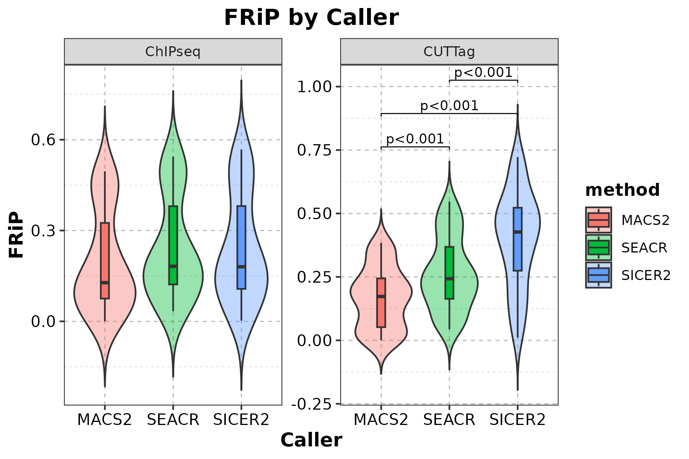

wd:(r4) researcher:/path/to/path/to/external_data
==Wilcox test: `exact = FALSE`：Use the asymptotic normal approximation for p-values, commonly used for larger sample sizes==

```R
library(ggplot2)
library(dplyr)
library(tidyr)

data <- read.table("data.txt", header = 1, sep = "\t")

# Reshape into long format:FRiP
frip_long <- data %>%
  select(sample, technique, frip_macs, frip_sicer, frip_seacr) %>%
  pivot_longer(cols = starts_with("frip_"), names_to = "method", values_to = "FRiP") %>%
  mutate(method = recode(method,
                         "frip_macs" = "MACS2",
                         "frip_sicer" = "SICER2",
                         "frip_seacr" = "SEACR"))

# Reshape into long format:Peak count
peak_long <- data %>%
  select(sample, technique, n_peaks_macs, n_peaks_sicer, n_peaks_seacr) %>%
  pivot_longer(cols = starts_with("n_peaks_"), names_to = "method", values_to = "Peak_Count") %>%
  mutate(method = recode(method,
                         "n_peaks_macs" = "MACS2",
                         "n_peaks_sicer" = "SICER2",
                         "n_peaks_seacr" = "SEACR"))
```


# 📊 Plot FRiP distribution

### technique + caller
```R

frip_plot <- ggplot(frip_long, aes(x = technique, y = FRiP, fill = technique)) +
  geom_violin(trim = FALSE, alpha = 0.4) +
  geom_boxplot(width = 0.1, outlier.shape = NA) +
  facet_wrap(~method, scales = "free_y") +
  theme_bw() +
  theme(
    axis.text.x = element_text(angle = 30, hjust = 1),
    strip.text = element_text(face = "bold")
  ) +
  labs(title = "FRiP Distribution by Technique", y = "FRiP", x = "Technique")

# 🖼️ Save figure
ggsave("FRiP_by_technique.png", frip_plot, width = 8, height = 5, dpi = 300)
```


> [!ocr-extractor]- Extracted text
> FRIiP Distribution by Technique
> of masz | |  seack | |  sicERz |
> 0.75
> 0.75
> 0.50
> 0.50
> 0.50
> technique
> [a
> xr 0.25 BH ChiPseq
> w 0.25
> 0.25 = CUTTag
> 0.00
> 0.00 0.00
> 095 -0.25
> eo 29 ed 29 eO 20
> o®” oC o®” oC o®” o<
> Technique

### caller + technique + Statistical tests
```R
library(dplyr)
library(tidyr)
library(ggplot2)
library(ggpubr)
library(rstatix)

# Read data
data <- read.table("data.txt", header = TRUE, sep = "\t")

# Long format:FRiP
frip_long <- data %>%
  select(sample, technique, frip_macs, frip_sicer, frip_seacr) %>%
  pivot_longer(
    cols = starts_with("frip_"),
    names_to = "method",
    values_to = "FRiP"
  ) %>%
  mutate(
    method = recode(
      method,
      frip_macs = "MACS2",
      frip_sicer = "SICER2",
      frip_seacr = "SEACR"
    ),
    method = factor(method, levels = c("MACS2", "SEACR", "SICER2"))
  )

# 1. Run all pairwise Wilcoxon tests
stat.test.all <- frip_long %>%
  group_by(technique) %>%
  pairwise_wilcox_test(
    FRiP ~ method,
    p.adjust.method = "none"
  )

# 2. Output p-values for all pairwise comparisons
pvalue_table <- stat.test.all %>%
  ungroup() %>%
  select(technique, group1, group2, n1, n2, statistic, p)

write.csv(
  pvalue_table,
  "FRiP_pairwise_Wilcox_pvalues.csv",
  row.names = FALSE
)

# 3. Generate statistical results for plotting separately
stat.test <- stat.test.all %>%
  add_xy_position(
    x = "method",
    scales = "free_y"
  ) %>%
  filter(p <= 0.001) %>%
  mutate(
    p_label = ifelse(
      p < 0.001,
      "p<0.001",
      paste0("p=", sprintf("%.3f", p))
    )
  )
    
# Plot
frip_plot <- ggplot(frip_long, aes(x = method, y = FRiP, fill = method)) +
  geom_violin(trim = FALSE, alpha = 0.4) +
  geom_boxplot(width = 0.12, outlier.shape = NA) +
  facet_wrap(~technique, scales = "free_y") +
    theme_bw() +
  theme(
    panel.grid.major = element_line(color = "gray70", linetype = "dashed", size = 0.3),
    panel.grid.minor = element_line(color = "gray85", linetype = "dashed", size = 0.2),
    plot.title = element_text(hjust = 0.5, face = "bold", size = 14, color = "black"),
    axis.title = element_text(face = "bold", size = 12, color = "black"),
    axis.text = element_text(size = 10, color = "black"),
    legend.title = element_text(face = "bold", color = "black"),
    legend.text = element_text(color = "black")
  )  +
  labs(
    title = "FRiP by Caller",
    x = "Caller",
    y = "FRiP"
  )

# Annotate only significant comparisons
if (nrow(stat.test) > 0) {
  frip_plot <- frip_plot +
    stat_pvalue_manual(
      stat.test,
      label = "p_label",
      tip.length = 0.01,
      step.increase = 0.08,
      size = 3   # Larger by default; reduced here; can be changed to 2.5
    )
}
# Save and display
ggsave("FRiP_by_caller.png", frip_plot, width = 6, height = 4, dpi = 300)


```



> [!ocr-extractor]- Extracted text
> FRiP by Caller
> p<0.001
> 1.00
> n<0.001
> 0.001 i
> 0.6 0.75 P=
> method
> o 0.50 = MACS2
> I 0.3
> ™ =] SEACR
> 0.25 = SICER2
> 0.0
> 0.00
> -0.25
> MACS2 SEACR SICER2 MACS2 SEACR SICER?2
> Caller

### 📊 Plot peak count distribution (log10)
```R

peak_plot <- ggplot(peak_long, aes(x = technique, y = Peak_Count, fill = technique)) +
  geom_violin(trim = FALSE, alpha = 0.4) +
  geom_boxplot(width = 0.1, outlier.shape = NA) +
  facet_wrap(~method, scales = "free_y") +
  scale_y_log10() +
  theme_bw() +
  theme(
    axis.text.x = element_text(angle = 30, hjust = 1),
    strip.text = element_text(face = "bold")
  ) +
  labs(title = "Peak Count Distribution by Technique", y = "Number of Peaks (log10)", x = "Technique")

# 🖼️ Save figure
ggsave("Peaks_by_technique.png", peak_plot, width = 8, height = 5, dpi = 300)
```


> [!ocr-extractor]- Extracted text
> Peak Count Distribution by Technique
> 1e+05
>
> 1e+05 1e+05
> 5)
> i
> (@)}
> °
> © 1e+03 le+04 technique
> © le+04
> id = ChIPseq
> Ye
> [e) CUTTag
> 5 E
> [0]
> a]
> E 1e+03
> = le+01
>
> 1e+03
>
> le+02
> ce 29 ed 29 eO 29
> oF < oF < oF <
> Technique

