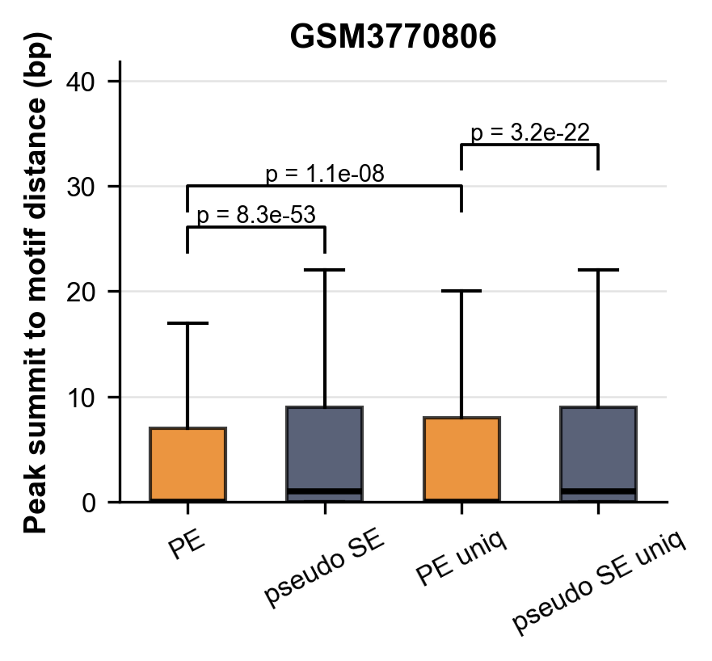

wd:/path/to/path/to/external_data/chip/sy_data/dist_to_motif_GSM3770806


Assume your sample ID is `GSM3770806`，The following commands regenerate the four input files used for the boxplot.As in the original script, retain peaks overlapping CTCF motifs, extract their summits, and calculate the distance from each summit to the nearest motif.
```shell
R=GSM3770806  
  
WD=./  
ctcf_motif=/path/to/lab_data/reference/ctcf/CTCF_map.bed  
  
PE=$WD/macs2_q0.05_dup1/${R}_peaks.narrowPeak  
SE=$WD/macs2_q0.05_dup1_imitateSE/${R}.random_end_peaks.narrowPeak  
PE_uniq=$WD/macs2_q0.05_dup1_imitateSE_uniq/${R}.uniq_peaks.narrowPeak  
SE_uniq=$WD/macs2_q0.05_dup1_imitateSE_uniq/${R}.uniq.random_end_peaks.narrowPeak
# 1. Extract summits of peaks overlapping motifs  
bedtools intersect -a $PE -b $ctcf_motif -u | \  
awk '{summit=$2+$10; print $1"\t"summit"\t"summit+1}' \  
> ${R}_PE_peaksWmotif_summits.bed  
  
bedtools intersect -a $SE -b $ctcf_motif -u | \  
awk '{summit=$2+$10; print $1"\t"summit"\t"summit+1}' \  
> ${R}_SE_peaksWmotif_summits.bed  
  
bedtools intersect -a $PE_uniq -b $ctcf_motif -u | \  
awk '{summit=$2+$10; print $1"\t"summit"\t"summit+1}' \  
> ${R}_PE_uniq_peaksWmotif_summits.bed  
  
bedtools intersect -a $SE_uniq -b $ctcf_motif -u | \  
awk '{summit=$2+$10; print $1"\t"summit"\t"summit+1}' \  
> ${R}_SE_uniq_peaksWmotif_summits.bed  
  
# 2. Calculate summit-to-nearest-motif distances and export one number per line to a TXT file  
bedtools closest -a ${R}_PE_peaksWmotif_summits.bed -b $ctcf_motif -d | \  
awk -F '\t' '{print $NF}' \  
> dist_${R}_PE_peaksWmotif_summits_wMotif.txt  
  
bedtools closest -a ${R}_SE_peaksWmotif_summits.bed -b $ctcf_motif -d | \  
awk -F '\t' '{print $NF}' \  
> dist_${R}_SE_peaksWmotif_summits_wMotif.txt  
  
bedtools closest -a ${R}_PE_uniq_peaksWmotif_summits.bed -b $ctcf_motif -d | \  
awk -F '\t' '{print $NF}' \  
> dist_${R}_PE_uniq_peaksWmotif_summits_wMotif.txt  
  
bedtools closest -a ${R}_SE_uniq_peaksWmotif_summits.bed -b $ctcf_motif -d | \  
awk -F '\t' '{print $NF}' \  
> dist_${R}_SE_uniq_peaksWmotif_summits_wMotif.txt
```

The four output files are:

```shell
dist_${R}_PE_peaksWmotif_summits_wMotif.txt  
dist_${R}_SE_peaksWmotif_summits_wMotif.txt  
dist_${R}_PE_uniq_peaksWmotif_summits_wMotif.txt  
dist_${R}_SE_uniq_peaksWmotif_summits_wMotif.txt
```

Then pass them to the Python script:

[[plot_box_peak_summit_to_motif_dist_uniq_UVAcolor.py]]

```shell
R=GSM3770806  

python plot_box_peak_summit_to_motif_dist_uniq_UVAcolor.py \
dist_${R}_PE_peaksWmotif_summits_wMotif.txt \
dist_${R}_SE_peaksWmotif_summits_wMotif.txt \
dist_${R}_PE_uniq_peaksWmotif_summits_wMotif.txt \
dist_${R}_SE_uniq_peaksWmotif_summits_wMotif.txt \
"${R}_box_peak_distance_to_motif_uniq_UVA.png" \
"$R"
```


> [!ocr-extractor]- Extracted text
> = GSM3770806
> 2 40
> S
> p = 3.2e-22
> 5 ] e
> Ww 30 p=1.1e-08
> - p =8.3e-53
> ©
> E 20
> S
> E
> S
> Im)
> x
> ® 0
> a < cc \O\ NO
> < oo° oe ge
> Q° O°
> °

